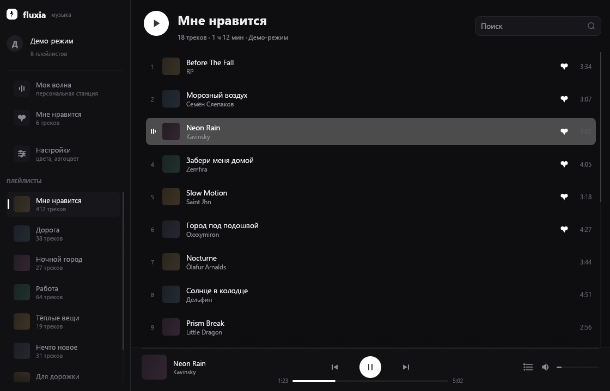
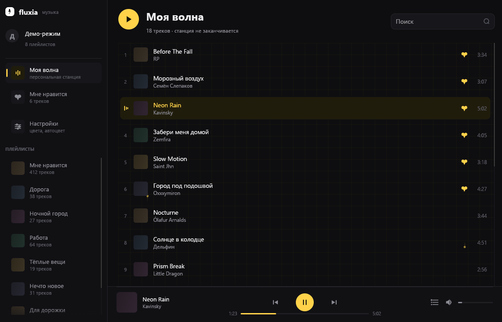
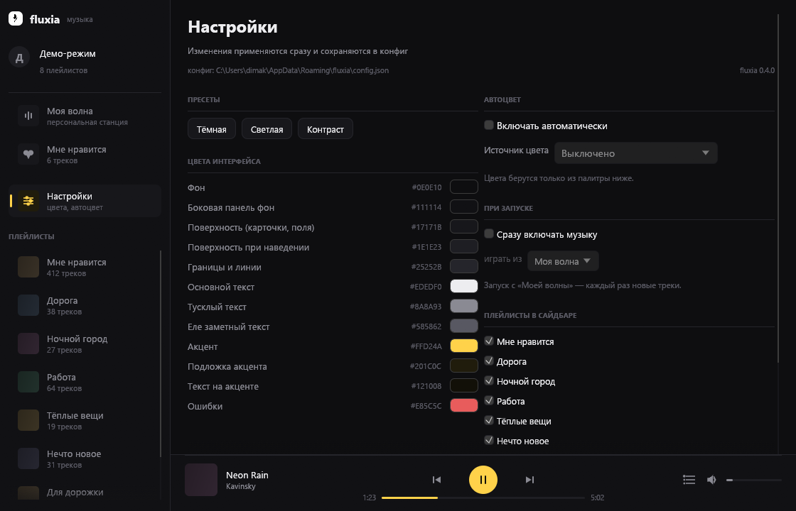

<p align="center">
  
</p>

# fluxia

Клиент Яндекс Музыки для Windows на Rust: `egui`/`eframe` для интерфейса,
`rodio` для звука. Один exe, без Electron и webview, около 15 МБ.

Тёмная тема, жёлтый акцент `#FFD24A`, все цвета интерфейса меняются в настройках.

> Неофициальный клиент: с Яндексом не связан, доступ — по своему OAuth-токену.



## Возможности

- «Моя волна» — rotor-станция, следующая порция треков подгружается сама
- «Мне нравится» — коллекция из аккаунта, лайк ставится и снимается из списка
- свои плейлисты с обложками, поиск по трекам
- очередь «Далее»: видно, что играет следующим, треки перетаскиваются мышкой
- настройки: 12 цветов, пресеты, автоцвет по обложке / времени суток / случайный
- автопроигрывание при запуске — «Моя волна» или «Мне нравится»
- заголовок окна красится в цвета интерфейса, углы скруглены (Windows 11)
- горячие клавиши: `Space`, `←`/`→`, `Ctrl+←`/`Ctrl+→`

<p>
  
  
</p>

## Установка

1. Скачай `fluxia.exe` из [Releases](../../releases).
2. Положи куда угодно и запусти.
3. Вставь OAuth-токен Яндекса на экране входа.

Windows 10/11 x64, установщик не нужен. Билд не подписан — SmartScreen может
показать «неизвестный издатель».

## Токен

Официального способа получить токен для стороннего клиента нет, поэтому он
берётся из веб-версии Яндекс Музыки (DevTools → Application → Cookies) и
вставляется в поле на экране входа. Хранится в открытом виде в
`%APPDATA%\fluxia\config.json` — не передавай этот файл никому.

## Конфиг

`%APPDATA%\fluxia\config.json`; если писать туда нельзя — `%LOCALAPPDATA%`,
затем папка с exe. Приложение пишет в тот файл, из которого прочитало, и читает
самый свежий: иначе правки уходили бы в другой файл и «не сохранялись». Путь
видно в настройках, а `fluxia.exe --config-info` кладёт отчёт в
`config-info.txt` рядом с exe.

## Сборка

```powershell
cargo build --release
```

Нужен Rust (MSVC или GNU-тулчейн; для GNU — MinGW-w64 с `windres`, иконка
вшивается через `embed-resource`). Результат: `target\release\fluxia.exe`.

Тесты: `cargo test --bin fluxia`.

Есть демо-режим без токена и сети — для отладки и скриншотов:

```powershell
fluxia.exe --demo --shot out.png
```

## Структура

```
src/
├─ main.rs        точка входа, окно, иконка
├─ app.rs         состояние, сетевые задачи, горячие клавиши
├─ theme.rs       палитра (меняется в рантайме), типографика, метрики
├─ icons.rs       иконки, нарисованные кодом, и логотип
├─ pipes.rs       фоновая анимация «труб» для «Моей волны»
├─ win.rs         цвет заголовка, скругление углов, локальное время
├─ player.rs      аудио-поток (rodio), позиция, громкость
├─ config.rs      конфиг: токен, цвета, автозапуск, скрытые плейлисты
├─ demo.rs        фейковые данные для --demo
├─ api/           обёртка над yandex-music: аккаунт, плейлисты, поток трека
└─ ui/            login, sidebar, tracklist, bar, settings

assets/           логотип и иконка (вшиты в бинарник)
shots/            скриншоты для README
```

## Ограничения

- нет офлайн-кэша: без интернета ничего не играет
- между треками пауза на загрузку следующего
- нет трея, медиа-клавиш и единого экземпляра
- интерфейс только на русском

## Лицензия

MIT, см. [LICENSE](LICENSE).
